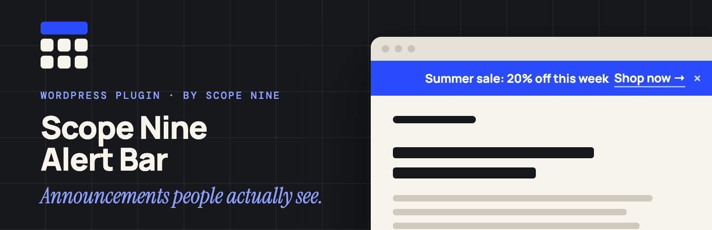
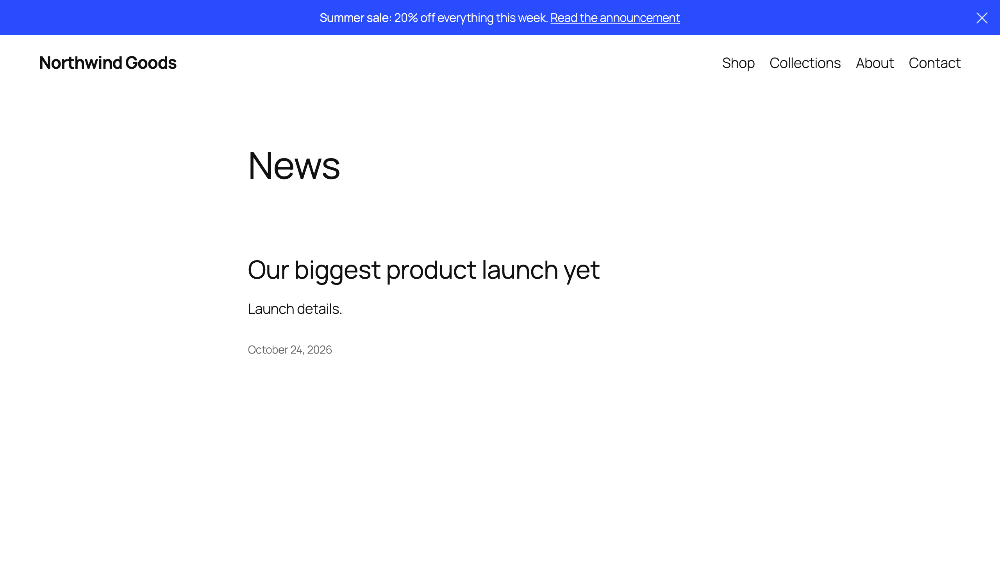

# Scope Nine Alert Bar

A lightweight, dismissible announcement bar for WordPress, with a live preview while you design it.

[**Install from WordPress.org →**](https://wordpress.org/plugins/scope-nine-alert-bar/)



## Features

- **Live Preview** — See changes in real-time as you customize
- **WYSIWYG Editor** — Rich text with bold, italic, links, and colors
- **Custom Colors** — Background and text colors with hex input support
- **Dismissible** — Close button with customizable icon
- **Display Options** — Site-wide, homepage only, or specific pages
- **Position Control** — Before or after header placement
- **Responsive** — Looks great on all devices
- **Padding Control** — Individual top/right/bottom/left values
- **Post Linking** — Link to posts with custom titles and expiry dates
- **Modern Admin UI** — Clean, intuitive settings interface

## Installation

Search for **Scope Nine Alert Bar** under **Plugins → Add New** in your WordPress admin, or:

1. Download the latest release from [WordPress.org](https://wordpress.org/plugins/scope-nine-alert-bar/)
2. Upload the `scope-nine-alert-bar` folder to `/wp-content/plugins/`
3. Activate it on the Plugins screen
4. Go to **Alert Bar → Design** to configure

## Usage

### Basic Setup

1. Navigate to **Alert Bar > Design**
2. Enter your message in the WYSIWYG editor
3. Customize colors and styling
4. Choose display options
5. Save changes

### Link a Post

1. Edit any post
2. Find the "Alert Bar" meta box
3. Check "Feature in Alert Bar"
4. Set optional custom title and expiry
5. Save the post

Only administrators can feature a post, and only published posts are linked.

## Styling

Add your own styles with WordPress's Additional CSS (Customizer or Site Editor). Target these classes:

```css
.scopenine-alert-bar {
    /* Main alert bar container */
}

.scopenine-alert-bar-content {
    /* Content wrapper */
}

.scopenine-alert-bar-close {
    /* Close button */
}
```

## Requirements

- WordPress 5.0+
- PHP 7.1+

## License

GPL-2.0+ - See [LICENSE](https://www.gnu.org/licenses/gpl-2.0.html)

## Contributing

Issues and pull requests are welcome. Releases are published to WordPress.org from this repo; `.wordpress-org/` holds the directory icon, banners, and screenshots.

## Author

Built by [Abdullah Sajjad](https://github.com/abdullahsajjad) at [Scope Nine](https://scopenine.com).
